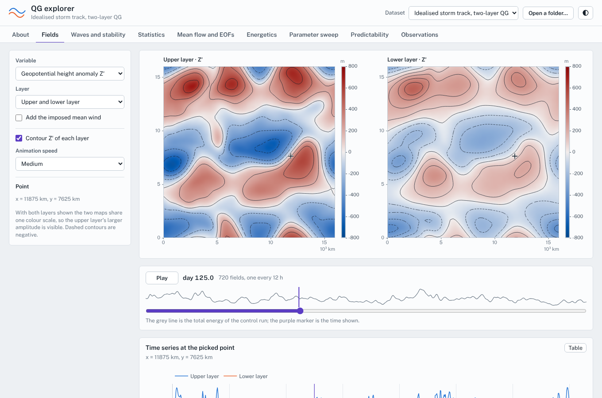
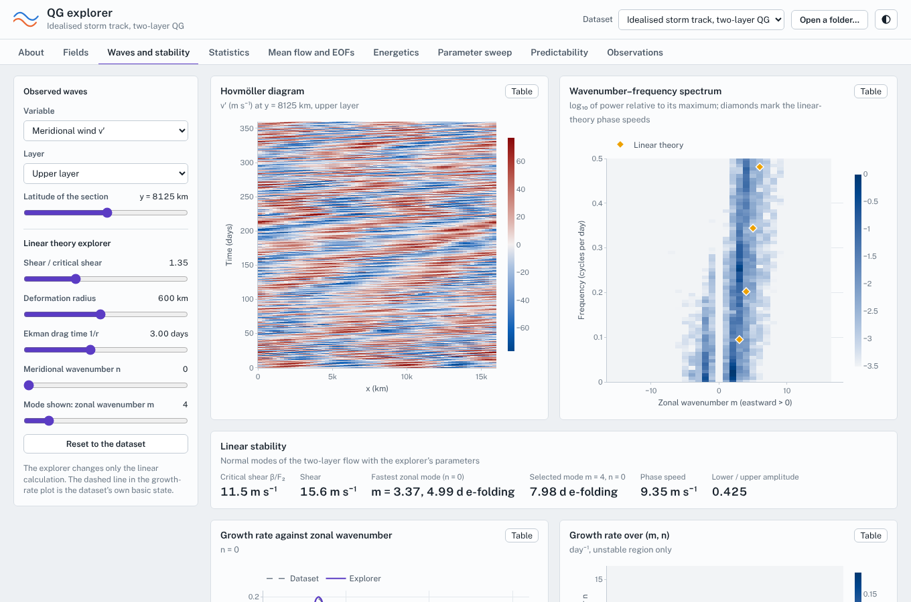

# QG explorer

An interactive website for a two-layer quasi-geostrophic storm-track model, and a tutorial for building the same kind of site for your own data.

The site is a set of static files in `docs/`. It needs no server-side code and no build step, so GitHub Pages can host it directly. All model output is precomputed. The browser does the analysis: maps and animation, Hovmöller diagrams, wavenumber–frequency spectra, EOFs, statistics, energy budgets, linear stability, ensemble predictability and a data-assimilation experiment. Anyone can clone the repository, run the model with their own parameters, and open the result in the same interface.



## Contents

1. [Quick start](#quick-start)
2. [The model](#the-model)
3. [Repository layout](#repository-layout)
4. [Running the model](#running-the-model)
5. [The dataset format](#the-dataset-format)
6. [The website, tab by tab](#the-website-tab-by-tab)
7. [Using your own data](#using-your-own-data)
8. [Publishing on GitHub Pages](#publishing-on-github-pages)
9. [How the site is built](#how-the-site-is-built)
10. [Exercises](#exercises)
11. [Tests](#tests)
12. [Troubleshooting](#troubleshooting)
13. [References and licences](#references-and-licences)

---

## Quick start

You need Python 3.11 or newer with NumPy. SciPy is optional; if it is installed the FFTs use it and are noticeably faster.

```bash
git clone <this repository>
cd qg-explorer
pip install -r requirements.txt

python -m qg2l info config/default.toml          # what the parameters imply (critical shear, fastest wave, ...)
python -m qg2l run config/quick.toml --out docs/data/quick     # a few minutes, a small dataset
python -m qg2l serve                             # http://127.0.0.1:8000, opens the browser
```

The repository ships with the full dataset `docs/data/default` (about 17 MB), so `python -m qg2l serve` works immediately. To regenerate it:

```bash
python -m qg2l run config/default.toml --out docs/data/default    # about 25 minutes on two cores on a laptop
```

`serve` is only a convenience wrapper around `http.server` for the `docs/` folder. The page has to be served over HTTP, because browsers do not allow `fetch` from `file://` URLs.

---

## The model

### What it is

Two stacked layers of fluid of different density on a β-plane, in a doubly periodic box. A uniform zonal wind blows in each layer, faster in the upper one. The vertical shear between the two winds is the energy source. Everything else, the waves, the eddies, the jets and the energy cascade, evolves freely from that.

The prognostic variable is the quasi-geostrophic potential-vorticity anomaly in each layer, $q_1$ and $q_2$. Streamfunctions $\psi_i$ follow from an inversion:

$$q_1 = \nabla^2\psi_1 + F_1(\psi_2-\psi_1), \qquad q_2 = \nabla^2\psi_2 + F_2(\psi_1-\psi_2)$$

with $F_1 = (1-\delta)/L_d^2$ and $F_2 = \delta/L_d^2$, where $L_d$ is the baroclinic deformation radius and $\delta = H_1/(H_1+H_2)$ the relative depth of the upper layer. The velocities are $u_i = U_i - \partial_y\psi_i$ and $v_i = \partial_x\psi_i$. The equations of motion are

$$\partial_t q_i + J(\psi_i, q_i) + U_i\,\partial_x q_i + \beta_i\,\partial_x\psi_i = -\delta_{i2}\,r\,\nabla^2\psi_2 + \mathcal{D}_i$$

with the background potential-vorticity gradients

$$\beta_1 = \beta + F_1(U_1-U_2), \qquad \beta_2 = \beta - F_2(U_1-U_2).$$

$r$ is a linear Ekman drag on the lower layer, and $\mathcal{D}$ a scale-selective filter ($\nabla^8$ hyperviscosity) that removes enstrophy at the grid scale. The height anomaly shown on the maps is $Z' = f_0\psi/g$, the geostrophic height anomaly of each layer's mid-surface. The site's maps and statistics use it because it is the variable meteorologists look at.

### Which phenomena it contains

- **Baroclinic instability** in its original form (Phillips 1954). Linear waves grow on the shear if it exceeds the critical value $\beta/F_2$. The growth rate, the fastest wavelength, the phase speed and the westward tilt with height can all be computed by hand and compared with the model.
- **Nonlinear equilibration.** Waves grow, saturate, occlude and decay. The life cycle of cyclones and anticyclones, a storm track.
- **Eddy–mean-flow interaction.** Eddies transport heat and momentum. They sharpen and shift the zonal-mean jets, which in turn change the eddy growth.
- **Rossby-wave propagation and wave–wave interaction**, with a $k$–$\omega$ spectrum that shows the dispersion relation.
- **Turbulent energy cascade.** Available potential energy is converted to eddy kinetic energy, kinetic energy moves upscale, and the lower layer's drag removes it. The model has a full energy budget that closes to round-off, so this is easy to verify.
- **Limited predictability.** Small errors grow, saturate at the climatological variance, and the growth is faster at small scales. The model is a standard test bed for ensemble prediction and data assimilation.

### What it leaves out, deliberately

- **No moisture, radiation, orography or boundary layer** apart from the single linear drag.
- **Two layers only.** The vertical structure is a barotropic mode and one baroclinic mode. There is no tropopause, no stratosphere and no critical-layer physics beyond that.
- **A uniform, fixed basic state.** The imposed winds $U_1$, $U_2$ do not change; supercriticality is held constant. Perturbations of the zonal mean *do* evolve, so jets form, but there is no localised jet to anchor a storm track and no meridional boundary.
- **Quasi-geostrophy.** Small Rossby number, no fronts, no ageostrophic dynamics, no gravity waves.
- **A doubly periodic plane.** No sphere, no metric terms and no variation of $f$ beyond $\beta$.

### Why it is useful

It is the simplest model in which the whole chain from linear theory to a statistically steady, turbulent storm track can be followed, and every step can be checked against analytics. The 660-day control run (300 days of spin-up and 360 days saved) on a 64×64 grid takes about a minute and a half on two cores, so a parameter sweep, a 20-member ensemble or a data-assimilation experiment, which would be a serious computing project with a primitive-equation model, takes minutes to tens of minutes. Everything the site shows is a diagnostic you could compute from a global model's output. Students and colleagues can see how the diagnostic behaves in a system whose equations fit on one line.

### Default configuration

| Quantity | Value |
|---|---|
| Domain | 16 000 × 16 000 km, 64 × 64 grid (250 km) |
| Deformation radius $L_d$ | 600 km |
| Layer depth ratio $\delta$ | 0.5 |
| β | 1.6 × 10⁻¹¹ m⁻¹ s⁻¹ |
| Mean winds $U_1$, $U_2$ | 20.5, 5 m s⁻¹ |
| Shear / critical shear | 15.5 / 11.52 m s⁻¹ = 1.35 |
| Fastest linear mode | wavelength 4750 km, e-folding 5.1 days |
| Ekman drag, spin-down time | 3 days |
| Time step | 1200 s (RK4) |

### Numerics and validation

Pseudo-spectral in space (`rfft2`) with 2/3 dealiasing, classical fourth-order Runge–Kutta in time, and a $\nabla^8$ filter whose e-folding time at the truncation wavenumber is 6 hours. The domain-mean potential vorticity is kept exactly zero. The test suite (`tests/test_model.py`) checks that

- the numerical linear growth rate equals the analytic Phillips result for $\beta=0$, equal layers and no drag;
- instability sets in at $U_1 - U_2 = \beta/F_2$;
- a normal mode integrated in the full model grows at the rate and with the phase speed the eigenvalue problem predicts;
- the Jacobian conserves energy and enstrophy to round-off;
- the diagnosed budget $\mathrm{d}E/\mathrm{d}t = C - D$ closes;
- halving the time step reduces the RK4 error by the expected factor.

---

## Repository layout

```
qg2l/                 the model, experiments and data pipeline (Python)
  model.py            Params, QG2L: pseudo-spectral RK4 integrator, energetics
  stability.py        linear normal-mode analysis (validated against Phillips)
  analysis.py         spectra and time-mean statistics used for the sweep
  obs.py              synthetic stations, EnSRF, Gaspari–Cohn localisation
  experiments.py      control run, parameter sweep, ensemble forecasts, assimilation
  export.py           binary array + JSON writer
  reference.py        numpy reference numbers stored in the manifest for the JS tests
  config.py, cli.py   TOML configuration and the command line
config/
  default.toml        the full configuration behind docs/data/default
  quick.toml          small, fast variant for trying things out
docs/                 the website (this folder is what GitHub Pages serves)
  index.html, css/
  js/                 ES modules, no build step; js/tabs/ has one file per tab
  lib/plotly.min.js   Plotly (cartesian bundle, vendored)
  fonts/              Public Sans and Source Serif 4 (vendored)
  data/               datasets; data/index.json lists the ones the page offers
tests/
  test_*.py           pytest: model, observations, export, config, pipeline
  js/                 node:test: browser diagnostics against numpy reference values
  browser/            Playwright scripts that open every tab and take screenshots
```

---

## Running the model

### Commands

```bash
python -m qg2l info  <config.toml>                 # derived parameters and linear-theory numbers
python -m qg2l run   <config.toml> --out <folder>  # run all enabled stages and write a dataset
python -m qg2l index <docs/data>                   # rebuild data/index.json
python -m qg2l serve [--dir docs] [--port 8000] [--no-browser]
```

`run` options: `--workers N` (processes for the parallel stages, default: all cores), `--stages control,sweep,ensemble,assimilation` (a subset; the control run is always included), `--workdir` (where restart files go, by default next to `--out`) and `--force` (ignore the cache).

### Stages and cost

| Stage | What it does | Default size | Cost (2 cores) |
|---|---|---|---|
| `control` | spin-up from a random state, then the record the site analyses | 300 days spin-up, 360 days saved every 12 h | about 1.5 minutes |
| `sweep` | one run per parameter value: shear / critical shear and drag time; keeps time-mean statistics | 13 runs of 150 + 150 days | about 10 minutes |
| `ensemble` | twin experiments from the control run: perturbed members, error growth | 3 groups × 20 members × 30 days | about 3 minutes |
| `assimilation` | synthetic stations and an ensemble Kalman filter, with different network sizes | 20 members, 4 networks and a free run, 60 days, 12 h cycles | about 10 minutes |

Each stage is cached by a hash of the configuration sections it depends on plus a code tag. Changing only the `[assimilation]` section re-runs only the assimilation. If the pipeline says "up to date" and you want to recompute anyway, add `--force`.

### Configuration reference

A configuration is a TOML file. Everything has a default except the `[model]` block, which you will normally copy from `default.toml`.

```toml
title = "…"                       # shown in the page header
description = "…"

[model]                           # every key is a field of qg2l.Params (SI units), plus three shortcuts:
nx = 64                           #   grid, powers of two (the browser FFT is radix-2)
ny = 64
Lx = 1.6e7                        # domain size, m
Ly = 1.6e7
f0 = 1.0e-4
beta = 1.6e-11
Ld = 6.0e5                        # deformation radius, m
delta = 0.5                       # H1 / (H1 + H2)
U1 = 20.5                         # imposed mean winds, m/s
U2 = 5.0
r_ek_days = 3.0                   # shortcut: Ekman spin-down time in days (instead of r_ek in 1/s)
shear_ratio = 1.35                # shortcut: set U1 so that (U1-U2) / critical shear has this value
dt = 1200.0                       # time step, s
filter_tau_hours = 6.0            # shortcut: hyperviscosity e-folding time at the truncation scale

[control]
seed = 1
spinup_days = 300
length_days = 360
output_hours = 12                 # must be a multiple of dt

[sweep]
enabled = true
spinup_days = 150
length_days = 150                 # averaging window
output_hours = 24
[[sweep.axis]]                    # any number of axes; each is run on its own, all else at the control value
parameter = "shear_ratio"         # or "r_ek_days"
values = [0.8, 1.0, 1.35, 2.0]

[ensemble]
enabled = true
start_day = 60                    # day of the control run used as the truth
members = 20
lead_days = 30
output_hours = 12
stamps = 6                        # members stored for the postage-stamp maps
[[ensemble.group]]                # initial-error experiments, one per group
name = "5 m, 2000 km"
amp_z = 5.0                       # standard deviation of the initial error, metres of Z'
wavelength_km = 2000              # dominant scale of the initial error

[assimilation]
enabled = true
start_day = 120
days = 60
cycle_hours = 12
members = 20
spinup_cycles = 20                # cycles excluded from the summary scores
obs_error_z = 10.0                # observation error, metres of Z'
variables = ["psi1", "psi2"]      # also possible: "u1", "v1", "u2", "v2" (error: obs_error_wind, m/s)
inflation = 1.1                   # multiplicative, tapered to 1 away from the stations (see qg2l/obs.py)
localization_km = 3000            # Gaspari–Cohn, vanishes at this distance
stations = [25, 50, 100, 200]     # network sizes to compare; the first k stations of a larger network are the same
primary = 100                     # network whose maps and station series are stored
```

The configuration is validated before anything runs. For example, grid sizes must be powers of two, output intervals must be multiples of the time step, and the ensemble and assimilation windows must fit inside the control run. Unknown keys are rejected so that typos do not pass silently.

One stability note: if a run reports that the CFL number is too large, lower `dt`, or raise the Ekman drag or the filter strength. Very supercritical settings (`shear_ratio` above about 2.5 at the default resolution) need a shorter time step, and the sweep stage halves the time step automatically for such cases.

---

## The dataset format

A dataset is a folder of small JSON descriptors and raw binary arrays. The browser reads them directly, with no conversion. `manifest.json` is the entry point:

```jsonc
{
  "format": "qg2l-dataset", "version": 1,
  "title": "…", "description": "…", "created": "…", "generator": "qg2l 1.0.0",
  "model": { "nx": 64, "ny": 64, "Lx": 1.6e7, "Ly": 1.6e7, "f0": 1e-4, "beta": 1.6e-11,
             "Ld": 6e5, "delta": 0.5, "U1": 20.5, "U2": 5.0, "r_ek": 3.86e-6, "g": 9.81, … },
  "grid":  { "nx": 64, "ny": 64, "Lx": 1.6e7, "Ly": 1.6e7 },
  "control": {
    "psi": { "file": "control_psi.i16", "dtype": "int16", "shape": [720, 2, 64, 64],
             "scale_axis": 1, "scale": [3475.45, 1994.35] },
    "start_days": 0.0, "step_hours": 12.0, "n": 720, "spinup_days": 300,
    "model_energetics": { "E": […], "C_B": […], "D_E": […], "D_h": […], … }   // optional
  },
  "sweep":        { "file": "sweep.json", "final_psi": {…}, … },              // optional products
  "ensemble":     { "file": "ensemble.json", "fields": { "truth": {…}, … }, … },
  "assimilation": { "file": "assimilation.json", "snapshots": {…}, "station_series": {…}, … },
  "reference":    { … }                                                         // only used by the JS tests
}
```

### Arrays

Every array is described by a descriptor object: `file`, `dtype`, `shape`, and for `int16` also `scale` (and `scale_axis`). The files are headerless little-endian, C order, so `shape` fully determines the layout. `int16` arrays are stored as `round(value / scale)` and decoded as `value = int16 × scale`. `scale` is either a number or, with `scale_axis`, one number per index along that axis. Layers have very different amplitudes, so the control run uses one scale per layer. Quantisation is at most 1/30000 of the largest value, far below anything the plots can show, and it halves the file size.

| File | Shape | Content |
|---|---|---|
| `control_psi.i16` | `[nt, 2, ny, nx]` | streamfunction $\psi$ of both layers, m² s⁻¹ |
| `sweep_final_psi.i16` | `[ncase, 2, ny, nx]` | final state of each sweep case |
| `ens_truth_psi.i16`, `ens_mean_psi.i16`, `ens_spread_psi.i16` | `[nlead, 2, ny, nx]` | truth, ensemble mean and spread (first group), one field per day |
| `ens_stamps_psi1.i16` | `[nstamp, nlead, ny, nx]` | individual upper-layer members |
| `assim_snapshots_psi.i16` | `[ncycle, 4, 2, ny, nx]` | truth, background mean, analysis mean, analysis spread at selected cycles |
| `assim_station_series.f32` | `[5, nvar, ncycle, nstation]` | truth, observation, background, analysis, background spread at each station |

Everything the site shows besides these fields (vorticity, wind, energetics, spectra, EOFs) is computed in the browser from $\psi$. That keeps the data small and makes the diagnostics transparent: `docs/js/physics.js` is the whole definition, and it is cross-checked against numpy in `tests/js`.

### Descriptors

`sweep.json`, `ensemble.json` and `assimilation.json` hold the experiment results: time series, profiles, spectra and scores, with floats rounded to six significant digits. Their structure is documented in the docstrings of `qg2l/experiments.py` and is easiest to understand by opening one.

`docs/data/index.json` lists the datasets the page offers in its selector:

```json
{ "datasets": [ { "id": "default", "path": "default/", "title": "…", "description": "…", "size_mb": 18.2 } ] }
```

`python -m qg2l index docs/data` regenerates it from the dataset folders it finds (every subfolder with a `manifest.json`).

---

## The website, tab by tab

Tabs appear only for products the dataset contains. A dataset with just a control run shows the first six (About to Energetics).

### About

The dataset's title, parameters, linear-theory numbers (critical shear, fastest-growing wavenumber, e-folding time, phase speed) and which products are present.

### Fields

Animated maps of any derived variable, in either layer, both layers side by side, or the barotropic and baroclinic parts. Variables: height anomaly, streamfunction, zonal and meridional wind, relative vorticity, potential-vorticity anomaly, total wind speed, eddy kinetic energy. Contours of $Z'$ are overlaid; dashed means negative. The colour range is fixed from a sample of the whole record, so animations do not flicker and amplitudes can be compared over time. **Click a map** to get the time series at that point; a purple marker follows the animation. The grey curve over the time slider is the total energy of the run.

*Things to try:* follow one cyclone for a week. Switch to relative vorticity to see how much sharper the small scales are than in $Z'$, and to the baroclinic part to see the vertical tilt of the waves.

### Waves and stability



- **Hovmöller diagram** of one variable along a line of constant latitude, and its **wavenumber–frequency spectrum**. Eastward-travelling waves appear at positive $m$. Diamonds mark the phase speeds predicted by linear theory for each zonal wavenumber.
- **Linear-stability explorer.** Sliders change the shear (as a multiple of the critical value), the deformation radius and the drag, and the page recomputes the growth rate against zonal wavenumber, the growth rate over the $(m,n)$ plane and the vertical structure of any selected normal mode: the amplitude ratio and phase lag of the two layers. The formulas are in `docs/js/linear.js`, a closed-form eigenvalue of a 2×2 matrix at each wavenumber.

*Things to try:* reduce the shear below 1.0 and see the instability vanish. Compare the fastest-growing linear wavenumber with where the spectrum is brightest. Raise the drag and watch the short-wave cut-off move.

### Statistics

For any variable and layer: the probability density against a Gaussian of the same mean and variance, a quantile–quantile plot that shows tail behaviour, the autocorrelation in time (with its 1/e time) and a Welch frequency spectrum. The distribution pools every grid point and time. The time statistics are averaged over 64 grid points.

*Things to try:* compare relative vorticity (skewed, heavy-tailed) with $Z'$ (nearly Gaussian), and eddy kinetic energy (strongly non-Gaussian, bounded below).

### Mean flow and EOFs

Time-mean zonal wind with its variability, eddy momentum flux, a time–latitude diagram of the zonal-mean wind anomaly, and the leading EOFs of the zonal-mean wind with their principal components and decorrelation time. The jets that form in a nominally uniform basic state are the model's version of the eddy-driven jet and its variability.

### Energetics

Energy reservoirs (zonal-mean and eddy, kinetic and available potential), the budget of conversion against Ekman and hyperviscous dissipation, and a table of time means with the turnover time and the closure error. At the bottom the time-mean spectra of kinetic and available potential energy against total wavenumber, with $k^{-3}$ and $k^{-5/3}$ reference slopes and the deformation wavenumber and fastest linear wave marked.

### Parameter sweep

How the statistically steady state responds to the shear and to the drag: a response curve of your choice (energy, eddy kinetic energy, heat-flux conversion, rms height…), the energy record of every case, time-mean wind profiles and spectra, and a map of the final state of any case. The vertical dashed line marks the control run and, for the shear, the critical value 1.

*Things to try:* look at the response near the critical shear. Is the energy zero below 1, or is it still decaying slowly at the end of the run (check the energy record)? How steeply does it rise above 1? What does strong drag do to the eddy length scale? The strongest shear cases develop unrealistically fast jets; the logarithmic axes keep the weaker cases visible.

### Predictability

Twin experiments. Each member starts from the truth plus a random error of given amplitude and scale and runs freely. Choose the measure (member error, ensemble-mean error, spread, or difference total energy) and see how the groups compare against the saturation level. The doubling-time table fits the early growth over a window you choose and compares it with linear theory. The error-spectrum plot shows how the error moves from small to large scales. Postage-stamp maps show the truth, the ensemble mean, the spread and individual members at any lead time.

*Things to try:* does a smaller initial error buy proportionally more lead time? Does the error scale matter once the error saturates? Is the early doubling time shorter than the linear one, and why?

### Observations

An observing-system experiment. Randomly placed stations measure the height anomaly of both layers with a stated error; an ensemble Kalman filter (serial EnSRF with localisation and inflation) combines them with a 12-hour forecast. The page compares network sizes (and a run with no observations), reports the scores, shows maps of truth, analysis, analysis error and analysis spread with the stations marked, and follows one station through time (truth, observation, background, analysis and the ensemble spread). Click a station on the truth map to select it.

*Things to try:* at which network size does the analysis error become smaller than the observation error? Is the ensemble spread consistent with the actual error, and what happens when the network is too sparse?

### Dark mode, tables and phones

The sun/moon button switches themes, and the page follows the system setting by default. Every chart has a **Table** button that shows the plotted numbers, so anything can be copied into your own analysis. The layout works down to a phone's width.

---

## Using your own data

### Run the model locally and look at the result

```bash
cp config/default.toml config/mine.toml        # edit it
python -m qg2l run config/mine.toml --out runs/mine
python -m qg2l serve
```

Then press **Open a folder…** in the page header and choose `runs/mine` (the folder that contains `manifest.json`). The data stay on your computer: the browser reads the files you picked, and nothing is uploaded. A disabled stage simply removes its tab.

Alternatively, write the dataset to `docs/data/<name>` and run `python -m qg2l index docs/data`; it then appears in the dataset selector, and it is published together with the site if you commit it.

### Use output from another model

Any model that can write a two-layer streamfunction on a regular, doubly periodic, power-of-two grid can use the site. The minimum is a `manifest.json` and one array:

```python
import json, numpy as np
from qg2l.export import Writer, FORMAT, VERSION

psi = my_model_output()                   # float array (nt, 2, ny, nx), m2/s, layer 0 = upper
w = Writer("runs/theirs")
desc = w.array("control_psi", psi, "int16", scale_axis=1)
manifest = {
    "format": FORMAT, "version": VERSION, "title": "My model", "description": "",
    "model": dict(nx=64, ny=64, Lx=1.6e7, Ly=1.6e7, f0=1e-4, beta=1.6e-11, Ld=6e5, delta=0.5,
                  U1=20.5, U2=5.0, r_ek=3.9e-6, g=9.81),
    "grid": dict(nx=64, ny=64, Lx=1.6e7, Ly=1.6e7),
    "control": dict(psi=desc, start_days=0.0, step_hours=12.0, n=psi.shape[0], spinup_days=0),
}
(w.outdir / "manifest.json").write_text(json.dumps(manifest))
```

All the Fields, Waves, Statistics, Mean-flow and Energetics analyses then work. If your model is not exactly this two-layer system, check that its relation between streamfunction and potential vorticity matches the one in the [model section](#the-model), because the derived fields (vorticity, PV, energetics) assume it. `docs/js/physics.js` shows precisely what is assumed. If you want the linear-theory curves, the parameters in `model` have to be the ones your simulation used.

To add the other tabs, write the matching products. `qg2l/experiments.py` shows what each one contains; the descriptors are plain JSON.

---

## Publishing on GitHub Pages

1. Create a repository on GitHub and push this folder to it.
2. **Settings → Pages → Build and deployment**: source *Deploy from a branch*, branch `main`, folder `/docs`. Save.
3. After a minute the site is live at `https://<user>.github.io/<repository>/`.

`docs/.nojekyll` is already there; it stops GitHub from running Jekyll on the folder. All paths in the site are relative, so it works under any repository name.

**Size.** GitHub rejects files above 100 MB and recommends repositories below 1 GB. Pages sites are limited to 1 GB. The default dataset is about 17 MB. If you use a 128×128 grid or a longer record, lower the output frequency (`output_hours`) or shorten `length_days`; the cost scales with the number of saved fields. Git LFS files are *not* served by Pages, so keep datasets as ordinary files.

**Updating data.** Re-run the pipeline, commit the changed files in `docs/data/` and push. The restart files of the cache (`docs/data/.work-*`) are ignored by `.gitignore`.

**Tests in CI.** `.github/workflows/tests.yml` runs the Python tests and the JavaScript tests (against a quick dataset it generates) on every push.

---

## How the site is built

There is no framework and no bundler. `docs/index.html` loads `js/main.js` as an ES module and Plotly as a plain script. This is deliberate: the whole site is readable, runs from any static host, and can be changed with a text editor.

| File | Role |
|---|---|
| `js/main.js` | dataset selector, folder loading, tabs, theme |
| `js/dataset.js` | `UrlSource` / `FolderSource`; array decoding; `Dataset` (snapshots, field series, cached) |
| `js/physics.js` | the diagnostics: derived fields, energetics, spectra, zonal means |
| `js/fft.js`, `eof.js`, `spectra.js`, `stats.js`, `linear.js` | numerical building blocks |
| `js/mapview.js` | canvas map: shading, contours, picking, colour bar |
| `js/colors.js` | colour ramps in OKLCH and the categorical palette |
| `js/ui.js` | Plotly theming, chart panels with table view, controls |
| `js/tabs/*.js` | one module per tab |

Design rules the code follows, and that you should keep when you add charts:

- **Colour follows the entity.** The upper layer is always blue and the lower layer always orange, in every chart. Ordered quantities (a sweep over shear, a lead time) use one hue from light to dark. Signed fields use a diverging blue–red ramp with a neutral midpoint, symmetric about zero.
- **Every chart has a legend or a title that says what each line is, a table view, and hover values.**
- **Dark mode is designed, not inverted.** The ramps have their own dark-mode steps.

### Adding a tab

A tab is a module whose default export is `create({ ds }, root)`. `ds` is the loaded `Dataset`, and `root` is the empty panel to fill. It returns an object with optional `activate()` (called each time the tab is shown; load data lazily here), `refresh()` (called after a theme change) and `destroy()`. Register it in the `TABS` list in `main.js`, with `needs: '<manifest key>'` if it depends on an optional product. `tabs/statistics.js` is a compact example.

### Adding a variable

Add an entry to `VARIABLES` and a branch to `Snapshot.field` in `physics.js`. It then appears in the Fields and Statistics tabs. If the quantity is also computed by Python, add it to `qg2l/reference.py` and a test to `tests/js/physics.test.js`.

---

## Exercises

Each uses only the site, a configuration change, or both.

1. **Phillips by hand.** On the Waves tab, set the explorer's shear to 1.0 and read off the critical shear. Confirm it equals $\beta/F_2 = \beta L_d^2/\delta$ using the numbers on the About tab. Then change $L_d$ and find how the critical shear scales.
2. **Which wave wins?** Compare the wavelength of the fastest-growing linear mode with the peak of the observed kinetic-energy spectrum in the Energetics tab. Why do they differ? (Hint: the inverse cascade, and the drag.)
3. **Steering level.** From the Hovmöller diagram, estimate the mean phase speed of the eddies. Where does that fall between $U_2$ and $U_1$, and what does the explorer say?
4. **Heat and momentum.** In the Mean flow tab, relate the eddy momentum flux to the jet position. Where do the eddies converge momentum?
5. **Drag and equilibrium.** Run the sweep on `r_ek_days` and plot eddy kinetic energy against drag time. Is the relation linear? Compare the turnover time $E/D$ with the drag time.
6. **Predictability limit.** Estimate the time at which the member error reaches half its saturation, for each initial-error group, and the doubling time. Add a group with `amp_z = 0.05` and see how much lead time one more decade of initial accuracy buys.
7. **Observation network design.** Add network sizes to `stations` and find the smallest network that brings the analysis error under the observation error. Try observing only the upper layer (`variables = ["psi1"]`) and see how well the lower layer is recovered through the covariances. Try `["u1", "v1"]` winds.
8. **Your own experiment.** Reduce `delta` to 0.2 (a shallow upper layer) or add `[[sweep.axis]]` entries for `"shear_ratio"` at several `r_ek_days`, run, open the folder in the page and describe what changed.

---

## Tests

```bash
python -m pytest                              # model, observations, export, config, pipeline
python -m qg2l run config/quick.toml --out /tmp/quick
QG_DATA=/tmp/quick node --test tests/js/*.test.js      # browser diagnostics against numpy values
python tests/browser/shots.py --out shots     # opens every tab in headless Chromium, reports console errors
python tests/browser/interact.py              # picking, animation, table view, theme, local-folder loading
```

The JavaScript tests read the same dataset the site does, and compare energetics, spectra, EOFs, moments and linear modes with reference numbers that the Python side wrote into the manifest. If you change a diagnostic in one language, the test tells you that the other one disagrees. The browser scripts need Playwright (`pip install playwright`) and a Chromium.

---

## Troubleshooting

| Symptom | Likely cause |
|---|---|
| The page is blank or says no datasets were found | Opened from `file://`. Use `python -m qg2l serve`. Or `docs/data/index.json` is missing: run `python -m qg2l index docs/data`. |
| “file 'manifest.json' is not in the selected folder” | You chose a folder above or below the dataset. Choose the one that contains `manifest.json`. |
| A tab is missing | The dataset has no such product. Check `enabled` in the configuration. |
| The first visit to a tab takes a few seconds | The browser is computing the field series, zonal means or spectra. Results are cached while the page is open. |
| `CFL` error while running | The flow is too strong for the time step. Lower `dt`, or increase drag or filtering. |
| Pages shows an old version | GitHub Pages caches for a few minutes. Force-reload. |

---

## References and licences

- Phillips, N. A. (1954). Energy transformations and meridional circulations associated with simple baroclinic waves in a two-level, quasi-geostrophic model. *Tellus*, 6, 273–286.
- Vallis, G. K. (2017). *Atmospheric and Oceanic Fluid Dynamics*, 2nd ed., Cambridge University Press. Chapters 5, 6 (the two-layer model and baroclinic instability) and 9.
- Lorenz, E. N. (1969). The predictability of a flow which possesses many scales of motion. *Tellus*, 21, 289–307.
- Whitaker, J. S. and Hamill, T. M. (2002). Ensemble data assimilation without perturbed observations. *Monthly Weather Review*, 130, 1913–1924.
- Gaspari, G. and Cohn, S. E. (1999). Construction of correlation functions in two and three dimensions. *Quarterly Journal of the Royal Meteorological Society*, 125, 723–757.

The code is under the MIT licence (`LICENSE`; replace the copyright holder). Third-party files in `docs/`: Plotly.js (MIT, `docs/lib/`) and the fonts Public Sans and Source Serif 4 (SIL Open Font Licence 1.1, `docs/fonts/`); their licence texts sit next to the files.
